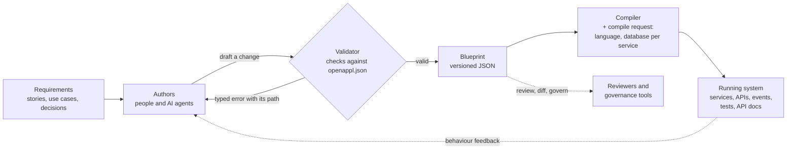

# How it works

> This page is mirrored from the [OpenAPPL website](https://openappl.org/), where the full ontology and specifications live.

OpenAPPL has three moving parts: a **blueprint** that describes the system, a
**compiler** that builds it, and the **running system** that comes out. The schema,
`openappl.json`, sits behind all three and defines what a valid blueprint is.



## 1. Write a blueprint

A blueprint is one JSON document. It is a tree with a single project at the root,
modules such as services under it, then data objects and business APIs, and finally the
typed settings inside them. Every key in the tree is a declared property of a pattern in
the schema, and every reference to another part of the blueprint (a data object, a
property) is typed, so a reference to something that does not exist is an error.

Here is a trimmed excerpt: one service, one data object and one API that only
organisation admins may call. Optional sections are left out; the compiler fills them in
with their documented defaults.

```json
{
  "projectSettings": {
    "basicSettings": { "name": "meetings", "fullname": "Meetings" }
  },
  "services": [
    {
      "serviceSettings": {
        "serviceBasics": { "name": "agenda", "description": "Meetings and action items" }
      },
      "dataObjects": [
        {
          "objectSettings": {
            "basicSettings": { "name": "actionItem", "description": "A follow-up from a meeting" }
          },
          "properties": [
            { "basicSettings": { "name": "title", "type": "String", "isRequired": true } },
            { "basicSettings": { "name": "organizationId", "type": "ID", "isRequired": true } },
            { "basicSettings": { "name": "isClosed", "type": "Boolean" } }
          ]
        }
      ],
      "businessLogic": [
        {
          "basics": {
            "apiOptions": {
              "name": "closeActionItem",
              "crudType": "update",
              "dataObjectName": "actionItem"
            },
            "authOptions": { "loginRequired": true, "checkRoles": ["orgAdmin"] }
          }
        }
      ]
    }
  ]
}
```

Notice what is not there: no route handler, no SQL, no framework, no language. The API
says what it is (an update of an action item) and who may call it (logged-in
organisation admins). From that, the compiler derives the whole lifecycle: reading and
checking the parameters, authentication and authorisation, fetching the item, the
update itself, shaping the response and emitting the event.

When the rule later becomes "members may also close items they created", the change is
one conditioned permission check added to this API. That is the diff a reviewer reads.

## 2. Validate as you go

Because the vocabulary is closed, a validator can check a blueprint completely before
compiling it: unknown keys, wrong types, missing required values and broken references
are all reported with the exact path of the problem.

This makes a tight loop for AI agents. An agent looks up the patterns it needs (the
documentation travels inside the schema), drafts a change, runs it through the validator,
repairs what is reported and only then writes it into the blueprint. Structural mistakes
never reach the code.

## 3. Compile

A compiler reads the blueprint together with a **compile request**. The request, not the
blueprint, chooses the technical stack, for example the programming language and the
database of each service. The same blueprint can therefore be compiled to different
stacks without being edited.

Everything else that is technical is the compiler's decision as well: deployment
topology, frameworks, ORM, message broker, session mechanics and API documentation. The
blueprint keeps only a short, closed list of technical selectors, such as which provider
an integration uses.

A deterministic compiler produces the same output for the same blueprint every time, so
regenerating is safe and a small blueprint change gives a small code change. Compilers
that use AI synthesis, or a mix of templates and AI, are equally allowed by the standard:
they consume the same validated blueprint.

## 4. Run, review, repeat

The output is a complete, runnable system: services with their data layer, APIs, events
and the tests and API documentation that go with them. The code is an output. You do not
edit it; you change the blueprint and compile again, so the whole codebase stays
consistent after the hundredth change exactly as after the first.

Where the patterns do not reach, OpenAPPL offers a small set of explicit extension
points: expressions written in the target language, library functions, hand-written edge
endpoints and imported packages. Each one is visible in the blueprint, so you always know
where hand-written logic lives.

Next: [Compilers](compilers.md) or [Get started](get-started.md).
